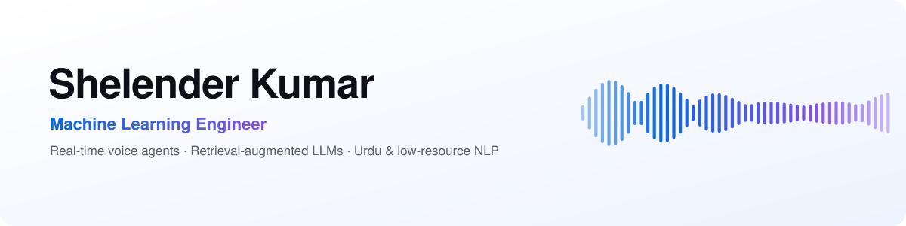

<a href="https://github.com/shelenderrkumar">
  <picture>
    <source media="(prefers-color-scheme: dark)" srcset="assets/banner-dark.svg">
    
  </picture>
</a>

  
  
  

### Hi, I'm Shelender 👋

I'm a machine learning engineer and a Computer Science graduate of **SEECS, NUST** (Pakistan).
I build AI systems that **listen, speak and read**: speech-to-speech agents you can phone,
retrieval-augmented assistants that cite their sources, and models for **Urdu**, a language
spoken by over 200 million people that is still underserved by AI.

I care about the gap between a demo and a dependable system: latency, failure modes,
evaluation and tests.

### 🔬 Research interests

- **Conversational speech agents**: turn-taking, interruption handling, tool use and latency in speech-to-speech models
- **Grounded generation**: retrieval quality, citation faithfulness and evaluation of RAG systems
- **Low-resource and multilingual NLP**: Urdu, code-switched Urdu-English speech and text
- **Vision-language learning**: image captioning and multimodal grounding

### 🚀 Featured work

<table>
<tr>
<td width="50%" valign="top">

#### 📞 [Realtime Voice Agent](https://github.com/shelenderrkumar/Twilio-OpenAI-Realtime-Voice-Bot)
A speech-to-speech AI agent you can **call on a real phone number**. It streams caller audio
between Twilio and the OpenAI Realtime API, handles barge-in, and runs tool calls
(tracking, a shopping cart, RAG) concurrently without blocking the audio. It speaks
English and Urdu.

`asyncio` · `WebSockets` · `FastAPI` · `LangChain` · `FAISS` 
✅ 38 tests, including an end-to-end simulated phone call

</td>
<td width="50%" valign="top">

#### 💬 [Stateful RAG Chatbot](https://github.com/shelenderrkumar/RAG-App)
A conversational agent modelled as a **LangGraph state machine with human-in-the-loop
interrupts**. It guides users through a flow, confirms before taking actions, and answers
free-form questions over a PDF with page citations. Replies stream over WebSockets.

`LangGraph` · `RAG` · `pypdf` · `FAISS` · `FastAPI` 
📏 Retrieval evaluation with hit rate@k and MRR

</td>
</tr>
<tr>
<td width="50%" valign="top">

#### 🖼️ [Urdu Image Captioning](https://github.com/shelenderrkumar/Urdu-Image-Captioning)
Generating image captions **in Urdu**. A ResNet-101 encoder and an attention-based GRU
decoder are trained on Flickr30k images with machine-translated Urdu captions, and
evaluated with BLEU.

`TensorFlow` · `Attention` · `Computer Vision` · `NLP`

</td>
<td width="50%" valign="top">

#### 🩺 [Medical Interpreter](https://github.com/shelenderrkumar/Healthcare-Translation-App-with-Gen-AI)
A two-way **clinician-patient speech interpreter** for 10 languages, including Urdu. It
transcribes with Whisper and translates with a constrained LLM prompt, then **flags dropped or
altered doses and numbers** (across Urdu, Hindi and Arabic digits) and shows a round-trip
back-translation.

`Whisper` · `OpenAI` · `Streamlit` · `gTTS` 
🛡️ Safety checks covered by unit and headless UI tests

</td>
</tr>
<tr>
<td width="50%" valign="top">

#### 🛰️ [DPI Guard: domain blocking with eBPF/XDP](https://github.com/shelenderrkumar/Network-Monitoring-App)
My final-year project, rebuilt as a research prototype. nDPI identifies the domain of each
connection, and an **XDP program drops blocked traffic in the kernel**. A ClientHello fast path
cut the time to block from **5.8 s to 0.8 ms**, stopping the very first connection.

`eBPF/XDP` · `nDPI` · `Linux networking` · `Python` 
📄 Paper draft in progress · measured on a real kernel testbed

</td>
<td width="50%" valign="top">

#### 📊 [Tweet Sentiment API](https://github.com/shelenderrkumar/Tweet-Sentiment-Analysis)
A REST service that serves a Transformer sentiment classifier, with CRUD storage,
bulk ingestion, Pydantic schemas, tests and Docker.

`Transformers` · `FastAPI` · `SQLite` · `pytest`

</td>
</tr>
</table>

### 🛠️ Toolbox

  
  
  
  
  
  
  
  
  
   
  
  
  
  
  
  
  
  

### 📫 Get in touch

I'm happy to talk about speech AI, RAG evaluation, or NLP for Urdu and other
low-resource languages. Reach me on [X / Twitter](https://twitter.com/shelenderrkumar)
or open an issue on any of my repositories.
